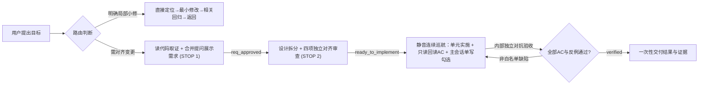

# Agent 职责与工作流（协议 4）

协议 4 以主会话主动路由为起点：明确局部低风险小修直接完成；常规与复杂需求通过两次人工确认锁定目标与契约，进入 `ready_to_implement` 后静音连续巡航直至内部独立对抗验收闭环交付。

## 角色分工

| 角色 | 适用场景 | 职责与写边界 |
| --- | --- | --- |
| [协调](../../agents/coordinator-agent.md) | 主会话接单、派发编排、进度汇总与收口 | 前期合并必答提问、严守两道批准门禁、唯一单写更新 `task.md` 勾选 |
| [产品](../../agents/product-agent.md) | 业务规则、边界状态或验收标准需澄清设计 | 代码取证、领域状态建模、产出带稳定编号的可判定 `F/AC` |
| [开发](../../agents/development-agent.md) | 模块契约设计、TDD 实现与独立技术审查 | 按单元单写实现、先 RED 后 GREEN、完成后只读回读 `AC` 锚点 |
| [Bug](../../agents/bug-agent.md) | 异常定位与根因修复 | 真实调用链取证、2～3 次无新证据盲修熔断、失败测试锁定最小修复 |
| [测试](../../agents/testing-agent.md) | 实施前四项规格对齐审查与最终独立对抗验收 | 只读源码与 `task.md`，亲自运行正向 `AC` 与最高风险破坏性反例 |

## 推进闭环

## 交接与阅读入口

- 跨角色派发遵循 [最小派发与单写交接](../../workflow/handoff.md) 的短卡片正反例规范，禁止把大段历史对话塞给子角色。
- 面向人的文档遵循 [文档分工与差量规范](../../workflow/documents.md)：首屏呈现阶段状态、核心结论与待确认项，`task.md` 维持 ≤ 100 行当前态，同事项续改按 Delta 差量就地演进。
- 四宿主适配与克隆恢复见 [宿主适配](../../workflow/host-adapters.md) 与 [setup Skill](../../skills/setup-requirement-workflow/SKILL.md)，外部可选 Issue 边界见 [项目配置与外部边界](../../workflow/config.md#可选issue关联)。
