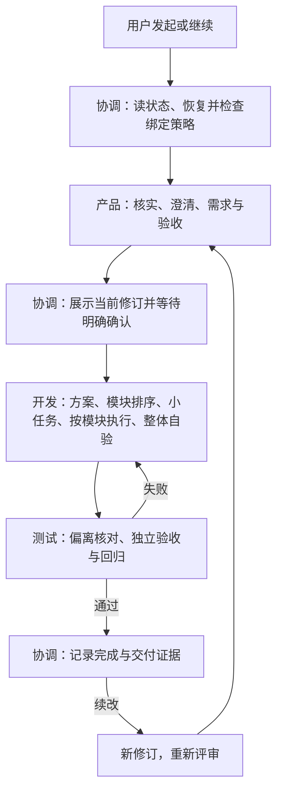

# Agent 职责与工作流

本文件说明分工与交接；各阶段的具体步骤、完成门槛和模板只在对应 Skill 中维护。整体目标及建设顺序见 [整体规划](overall-goals.md)。

## 角色边界

| 角色 | 负责 | 不承担 | 权威入口 |
| --- | --- | --- | --- |
| 协调 | 需求身份/修订、状态路由、宿主派发、交接、用户确认和索引 | 产品分析、实现、独立验收 | [coordinator-agent](../../agents/coordinator-agent.md) |
| 产品 | 核实现状、关键问题澄清、业务规则、需求和可验证验收 | 自批需求、业务代码或技术实现决策 | [requirement-analysis](../../skills/requirement-analysis/SKILL.md) |
| 开发 | 技术方案、模块排序、小任务、模式选择、实现及完整自验/基线 | 改验收、替代测试最终通过 | [feature-development](../../skills/feature-development/SKILL.md) |
| 测试 | 需求/实现/用例偏离、独立验收、回归、缺陷及限制 | 修改业务代码、迁就实现改变需求 | [acceptance-testing](../../skills/acceptance-testing/SKILL.md) |

协调统一更新根状态、固化文稿和维护索引；阶段角色只写当前任务授权范围并提交结果。Skill 是角色内部指令和资源，加载 Skill 不等于新增 Agent。

## 流程与交接

图表示阶段关系，不要求恢复时从头执行。实际先处理 active_run、waiting_user、blocked，再按 [路由规则](../../workflow/routing.md) 选择唯一下一动作。需求规则改变走新修订；仅批准范围内的修复留在当前版。

| 交接 | 必要内容 | 接收方 |
| --- | --- | --- |
| 派发阶段任务 | 身份/修订/run、必读资料、审批与适用基线、授权路径、结果位置 | 对应阶段角色 |
| 产品 ready | 需求、验收、自检及本版差异 | 协调展示，用户确认 |
| 开发 ready | 实现、自验及真实代码基线 | 协调核对交接后派发测试 |
| 测试 passed/failed/blocked | 对应基线的实际结果、缺陷/未执行项和证据 | 协调完成、回开发或保留测试阻塞 |
| needs_input/过期/异常 | 具体问题、事实或身份冲突，不猜测完成 | 协调转达或核查，保留历史 |

共同接单和路径约定见 [执行契约](../../workflow/execution-contract.md)，任务及结果见 [交接规则](../../workflow/handoff.md)，开发与测试共享 [代码基线](../../workflow/code-baseline.md)。协调只核对交接完整性，不替角色补缺失内容。

## Skill 与最小产物

- 产品默认一份 requirements.md，合并续改差异和自检；先查事实，再按依赖分轮问关键问题，信息充分直接整理。
- 开发默认一份 development.md；复杂/高风险才展开技术方案、模块任务计划、自验三份。按依赖拆可独立验证模块，再拆小任务，逐模块选择普通/长任务，最终完整功能自验。
- 测试默认一份 test-report.md，合并用例、偏离核对与结果；复杂用例才独立。先检查高风险和关键链路，不以局部环境阻塞掩盖可执行检查。
- 每个角色按条件读取所属 Skill 中的真实模板，在 task.output_dir 实例化；另交 result.yaml。问题/阻塞不要求空文稿或额外报告。

## 支持能力与宿主

[setup-requirement-workflow](../../skills/setup-requirement-workflow/SKILL.md) 负责宿主无关的包身份、版本锁与项目初始化，通过三个独立薄适配生成原生角色，不参与阶段调度。[issue-tracking](../../skills/issue-tracking/SKILL.md) 是协调主会话的可选支持能力，处理已有 Issue 绑定、授权评论与恢复；不新增业务角色或阶段 Skill 注册链接。

阶段角色不操作 Issue。绑定为前置策略，留痕在本地事实落盘后进行；远端失败仅影响同步，不清空审批/基线、不阻止已授权后续业务。外部评论不充当用户审批。文档/飞书能力仍遵循具体任务授权。

宿主适配负责真实角色注册、锁定包/Skill可达和原生调用/恢复；文件存在、手动加载与原生激活分开验证。当前验证状态见 [验证索引](../verification/README.md)，不在本文件复制历史测试结论。
