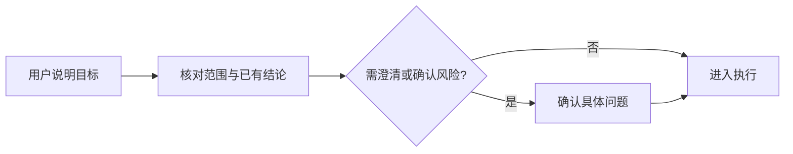
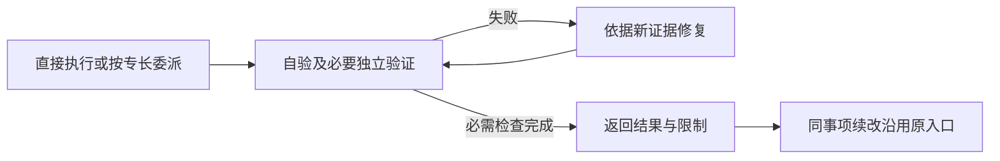

# Agent 职责与工作流

当前协议3以主会话直接执行为起点：信息不足才澄清，需要其他专长才委派，需要长期跟踪才维护 task.md 协调入口。复杂需求在实施前分别维护或引用需求、技术设计及实施安排；一般事项可合并记录。角色按专长选用。

## 角色分工

| 角色 | 适用情形 | 负责的结果 |
| --- | --- | --- |
| [协调](../../agents/coordinator-agent.md) | 主会话接单、交接或恢复 | 明确目标与范围，合并必要结论，维护单一入口 |
| [产品](../../agents/product-agent.md) | 规则或验收不清 | 核实现状，澄清影响执行的决策，给出可验证行为 |
| [开发](../../agents/development-agent.md) | 实现需要对应专长 | 完成允许范围内的改动和相关自验 |
| [Bug](../../agents/bug-agent.md) | 需要定位或修复缺陷 | 沿真实调用链诊断，最小修复，回归验证 |
| [测试](../../agents/testing-agent.md) | 用户要求或具体风险需要独立验证 | 核对当前改动，报告实际结果、缺陷和限制 |

Skill 是角色读取的指令与资源，加载 Skill 不等于新增 Agent。项目规则及 [执行约定](../../workflow/execution-contract.md) 决定实际边界。

## 工作如何推进

先核对目标与范围，再根据复杂度形成或引用所需需求、技术设计和实施安排，进入执行；图分两段阅读。

执行中根据检查结果修复，续改时重新核对范围并沿用原入口。

仅在跨会话恢复、交接或多步跟踪确有需要时维护 task.md；一次性局部低风险小修直接在当前会话完成。付款、权限、数据删除或大范围共享逻辑变更先确认具体范围并独立验证。

## 交接给什么

交接只提供目标项目、当前目标、允许范围、改动、已验结果、未决项和必要原生任务引用。已有资料通过链接读取，文档保持单写，由原写入者合并必要结论。未知调用先查原结果，不能当作已结束重新执行。

委派、恢复及具体限制见 [最小交接](../../workflow/handoff.md)；同事项与旧协议归属见 [续改规则](../../workflow/revisions.md)。

## 人怎样阅读成果

需要持久跟踪时，从 task.md 查看当前状态、目标摘要、实施任务、验证摘要和阻塞，按链接读取相关正文。复杂需求按 [文档分工](../../workflow/documents.md#按复杂度选择文档) 在实施前维护需求和技术设计，按依赖拆分实施单元，验收时维护实际证据；一个事项可包含多个原生实施任务。文档各自维护职责内容，进度集中在 task.md。

模板遵循 [人读文档格式](../../workflow/documents.md#人读文档格式)。安装由 [setup Skill](../../skills/setup-requirement-workflow/SKILL.md) 处理，外部 Issue 按 [Issue 规则](../../workflow/issue-tracking.md) 处理；安装事实、原生激活、业务闭环和外部发布分别验证。
