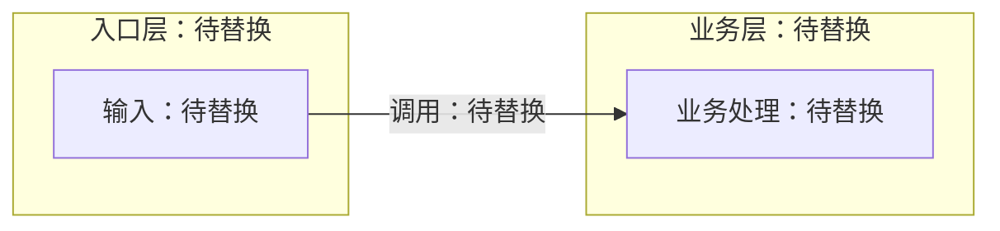

# {{事项名称}}：必要设计

> 填写提示：只在有真实设计决策或接口影响时使用。它是实现前的简短说明，不是第二份需求或进度账本。

## 要解决的问题

[待填写：现状、目标和约束。]

## 方案

[待填写：关键入口、数据流、实现步骤和取舍。]

> 图示提示：模块边界或依赖变化优先用架构图；处理流程用流程图，跨模块交互用时序图。以下只是架构图语法示意，按实际内容替换或删除，现状与拟议方案分别标明。

## 依赖与接口

| 项目 | 说明 |
| --- | --- |
| 模块或接口 | [待填写] |
| 异常行为 | [待填写；不适用时说明原因] |

> 代码提示：接口用项目实际语言的代码块，请求响应用 json，配置用 yaml，命令用 bash；注明用途和关键异常，只保留必要片段。

## 检查方法

- [待填写：如何确认关键行为和受影响路径；执行进度和结果记录在 task.md。]

> 设计结论和实际结果仍需回写当前任务文档。
