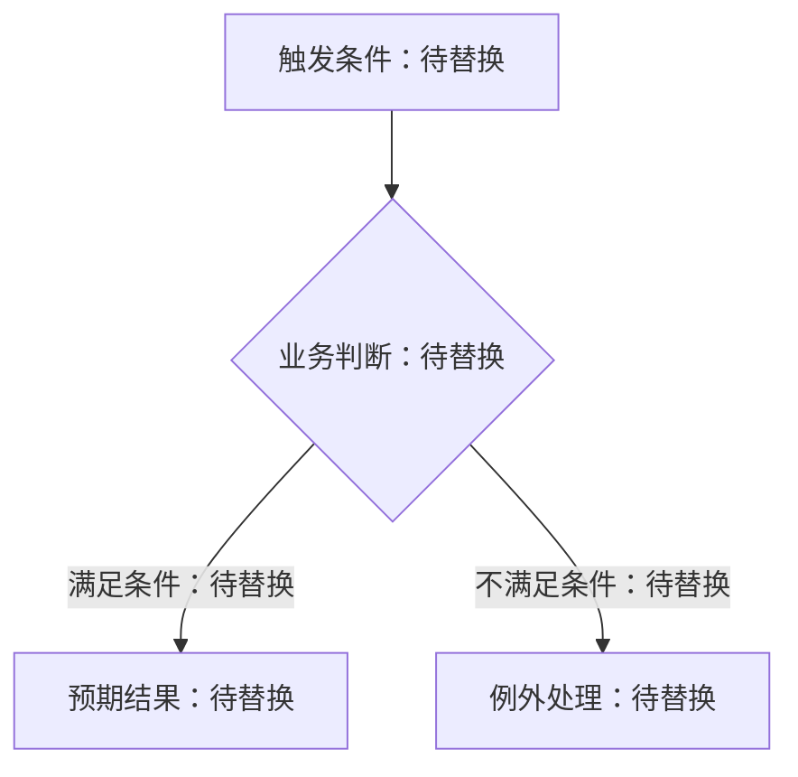

# {{事项名称}}：业务规则补充

[待填写：用一两句话说明本稿结论和适用对象；当前进度见 task.md。]

> 填写提示：仅在当前任务文档放不下复杂规则时使用。本稿解释规则，不承担任务进度；结论和未决项要回写当前 task.md。

| 项目 | 内容 |
| --- | --- |
| 适用范围 | [待填写] |
| 最近更新 | [待填写：YYYY-MM-DD] |

## 业务规则

[待填写：按优先级或用户流程列出规则。]

> 图示提示：涉及业务步骤、判断分支或异常流转时优先用 Mermaid 流程图；状态变化用状态图。图后说明影响验收的规则和例外。以下仅为语法示意，实例化时替换或删除。

## 可验证例子

| 场景 | 输入或前置条件 | 预期结果 |
| --- | --- | --- |
| [待填写] | [待填写] | [待填写] |

## 异常与边界

- [待填写：异常行为、空值、重复操作或权限边界。]

## 仍需决定

- [待填写；没有则写“无”。]
