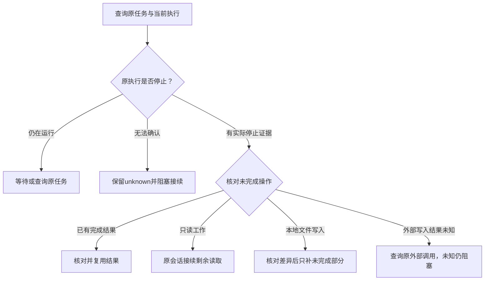

# 宿主适配契约

初始化按 [宿主选择规则](../skills/setup-requirement-workflow/references/installation.md#宿主选择与批量初始化) 加载全部目标宿主行；业务协调派发只加载当前实际宿主一行。统一产品/开发/测试/Bug角色及交接，宿主只负责真实注册、文件读取、派发、等待、结果和恢复；不复制阶段业务规则。

| host | 原生角色 product / development / testing / bug | 定义位置 | 适配说明 |
| --- | --- | --- | --- |
| codex | requirement_product / requirement_development / requirement_testing / requirement_bug | .codex/config.toml 受管registry区块 + .codex/agents/*.toml | [Codex](../skills/setup-requirement-workflow/references/codex-adapter.md) |
| claude-code | requirement-product / requirement-development / requirement-testing / requirement-bug | .claude/agents/*.md | [Claude Code](../skills/setup-requirement-workflow/references/claude-code-adapter.md) |
| opencode | requirement-product / requirement-development / requirement-testing / requirement-bug | .opencode/agents/*.md | [OpenCode](../skills/setup-requirement-workflow/references/opencode-adapter.md) |

## 确定的模板参数

原生文件以UTF-8/LF写入：product对应role=product-agent、role_file=agents/product-agent.md、skill_file=skills/requirement-analysis/SKILL.md、description=澄清需求并输出验收标准；development对应development-agent、agents/development-agent.md、skills/feature-development/SKILL.md、description=实现已批准需求并完成自验；testing对应testing-agent、agents/testing-agent.md、skills/acceptance-testing/SKILL.md、description=独立验收当前开发基线并报告缺陷。bug 对应 bug-agent、agents/bug-agent.md、skills/bug-fixing/SKILL.md、description=诊断并修复缺陷并完成自验。native_name取上表，不自行润色描述。

先对role-body.md进行上述原样字符串替换，再将完整正文（包括末尾换行，不strip/rstrip）替换原生模板的role_body；其他占位符同样替换，保留模板其余字节。共同入口、桥接和忽略区块使用模板完整原字节，不自选空白风格。追加时保留原文：原文非空且不以LF结束则先补一个LF，再追加完整模板；区块拥有摘要包含起始标记至结束标记后的LF，不包含原文或分隔LF。已有锁保持原字节，不要求其他机器重序列化。这样克隆后无本机回执也能确定性核对薄文件和拥有区块。

## 初始化输出与能力

本机回执 schema_version=2：package（真实四字段身份）、framework_path（项目相对路径）、owned_files（路径与实际SHA256）、owned_blocks（文件、标记、区块实际SHA256）、hosts。普通已有文件不作为整体拥有项；AGENTS/CLAUDE/.gitignore/.codex/config.toml 只拥有指定区块。默认初始化当前宿主和项目检测到的宿主；显式范围优先。全部目标先预检，再用同一 pending 安装，共享一份锁和缓存。非当前宿主只准备文件，不启动其程序；逐宿主报告 file_installation 和原生 pending。

hosts.<host> 保存实际可取得的 host_version（不可得=null）、role_mapping、file_installation、entry_probe、四个 native_role_probes（status、真实host_task_id或null、实际结果/原因）、native_role_invocation、end_to_end。状态为 passed/pending/failed；相同包下追加宿主时保留其他宿主有效回执，不把它们改成当前宿主通过；升级或拥有内容变化则将旧探测连同原包身份移入 hosts.<host>.probe_history，当前探测重置 pending。缺少回执时，不能接管归属尚未确认的已有文件。

current host 必须来自实际会话或用户明确选定，不能从项目名称或安装目录推断。检查可用的注册格式、文件读取、原生角色选择、委派、等待/结束事实、恢复/查询、项目权限及外部连接；工具名和版本以实际宿主为准。不强行改模型/权限或安装宿主工具。原生选择缺失记 host_role_selection_unavailable，委派缺失记 host_delegation_unavailable；未知宿主返回 unsupported_host。某版本格式不支持时返回 host_format_unsupported，不套用另一个宿主配置。

文件校验只证明适配文件完整。生效后，分别实际调用四个角色，并传入 initialization_probe=true 及当前机器上的项目、锁文件和框架路径；角色只读核对框架身份、角色、完整Skill及模板，返回实际事实。保存真实任务标识；缺标识说明限制。入口与四个原生探测均通过才将当前宿主 native_role_invocation=passed，不能用通用 Agent 阅读定义替代。不提供统一的重载命令，按实际能力启动新会话/重载；缺能力保持 pending。安装探测不执行 Issue/飞书写入，不创建业务需求。

回执中的 unavailable/pending 是上次探测事实，不能直接推断当前会话仍缺能力。当前会话实际提供映射的原生角色选择及委派工具时，重新执行只读探测并保存新任务标识及结果；工具出现本身不算 passed，end_to_end 仍只由真实需求闭环证明。

## 业务派发和恢复

仅在确需另一专长时按当前host映射调用原生角色，消息带项目根、目标和允许范围、已有结果及未决项，已有文档需要时引用；不以缺文档阻塞一次性小修。角色加载共享角色和完整Skill，不要求task.yaml、invocation_id、host/result、授权版本或delivery。原生任务保存调用与结束事实；文档仅在恢复确有需要时引用任务，不重复建立账本。

旧锁旧任务由原包解释，禁止跨协议续写。更换宿主前先核实原任务已结束，新宿主角色激活另行验证；未知外部操作先查询，不重放。主会话能完成的简单工作可以直接执行；缺委派能力只阻塞实际需要的委派，不能冒称原生角色已激活。

### 恢复判定与接续

客户端断连、服务重启或旧记录停在streaming时，先按原任务ID查询真实宿主，核对项目、包绑定、消息和已产生结果。持久消息状态与当前执行状态分别判断：CLI退出、页面静止或活动列表暂时缺席，单独都不能证明原执行已经停止。

停止证据采用宿主实际结束/取消状态，或原执行进程已退出且宿主查询确认没有活动执行；无法取得可靠证据时保持unknown。服务重启后的旧streaming消息不是运行证明，也不是完成证明，不为解除阻塞修改历史消息或伪造结束状态。

确认原执行停止后，先复用已有结果。只读工作可以在原会话发一次明确的接续消息，引用中断事实和未完成范围；本地写入还须先核对当前文件差异、部分落盘与并写情况，仅补当前授权内的缺口。无法排除并写或确认落盘结果时停止。原会话不可恢复时，才交接原引用和上述已核实事实到新会话，不整单重发。

外部写入必须查询原操作结果；原进程结束不代表外部操作失败，查不清仍阻塞，不重放。接续后再次按原任务查询完成事实、验证实际结果，保留原中断记录；只有新证据成立才报接续完成。人工接续通过不等于宿主自动恢复通过。

## 方案通信

复杂工作有必要先通知实现思路时，直接在原调用通信并继续，不结束重派、不生成展示事件和通知文件。任务文档保持单写，角色返回实际改动、验证和限制，由文档写入者合并。
